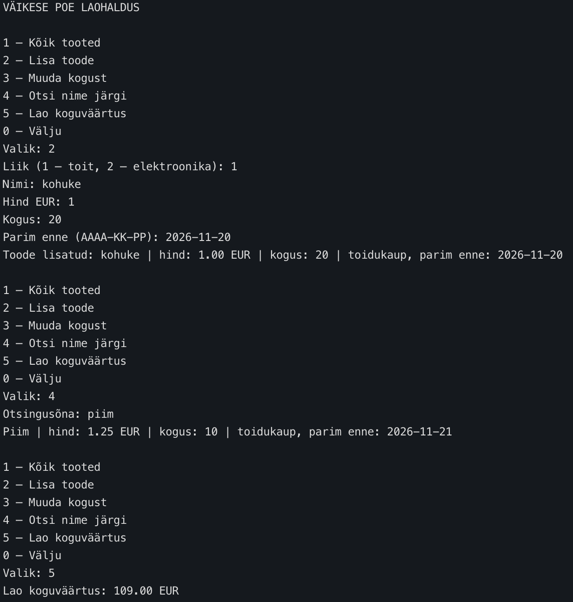

# Väikese poe laohaldus

Java konsoolirakendus, millega saab kuvada kõiki tooteid, lisada tooteid,
muuta laokoguseid, otsida nime järgi ja arvutada lao koguväärtust.
Rakendus käivitub kolme tootega: Piim, Leib ja Klaviatuur.

## Käivitamine

Vajalik on JDK 17 või uuem (`java` ja `javac`). Väliseid Java teeke ega Mavenit ei ole vaja.
macOS-is või Linuxis käivita projektikaustas:

```sh
./run.sh
```

Kõigis operatsioonisüsteemides saab käivitada ka käsitsi:

```sh
javac -encoding UTF-8 --release 17 -d build src/ee/laohaldus/*.java
java -cp build ee.laohaldus.Main
```

Vali menüüst number ja vasta küsimustele. Hinna võib kirjutada komaga või punktiga,
näiteks `25,50`. Kuupäev peab olema kujul `2027-01-31`.
Tooteliik `1` on toit ja `2` elektroonika. Koguse muutmisel tähendab `5` viie ühiku
lisamist ning `-2` kahe eemaldamist. Muutmiseks sisesta toote täpne nimi;
suur- ja väiketähtede erinevus ei loe. Otsing leiab ka nimeosa, näiteks `pi` leiab Piima.
Valik `0` lõpetab programmi. Sisendvoo lõpp lõpetab samuti programmi viisakalt.

Andmed asuvad mälus: programmi sulgemisel muudatused kaovad ning järgmisel
käivitamisel laaditakse uuesti kolm algtoodet. Faili või andmebaasi salvestamine
ei kuulu selle ülesande lahendusse.

## Kontrollimine ja käivitustõend

```sh
./test.sh
```

Testiskript vajab lisaks Python 3. Testitakse laoloogikat ja päris Java
konsooliprotsessi: lisamist, osalist otsingut, koguste muutmist, täpset koguväärtust,
vigast sisendit ja sisendi lõppu. Lahendus kompileeriti JDK 27-ga Java 17 sihtversioonile
ning mõlemad testikomplektid läbisid edukalt.

Käivitustõend näitab kohukese lisamist (20 tk hinnaga 1,00 EUR),
Piima otsimist ja lao koguväärtust 109,00 EUR.



## Failid

| Fail | Ülesanne |
| --- | --- |
| `src/ee/laohaldus/Product.java` | Abstraktne toode, hind, nimi, kogus ja kontrollitud muutmine |
| `src/ee/laohaldus/FoodProduct.java` | Toidukaup koos säilivuskuupäevaga |
| `src/ee/laohaldus/ElectronicProduct.java` | Elektroonika koos garantiikuudega |
| `src/ee/laohaldus/Inventory.java` | Toodete kogum, otsing, lisamine ja koguväärtus |
| `src/ee/laohaldus/Main.java` | Konsoolimenüü, sisend ja väljund |
| `test/` | Laoloogika ja konsooli testid |
| [Lahenduse selgitus](docs/selgitus.md) | Tööpäevik, OOP näited, andmestruktuur ja nõuete vastavus |
| [Commit'ide loetelu](docs/commitid.md) | Sisulised arendusetapid ja Git-ajalugu |
